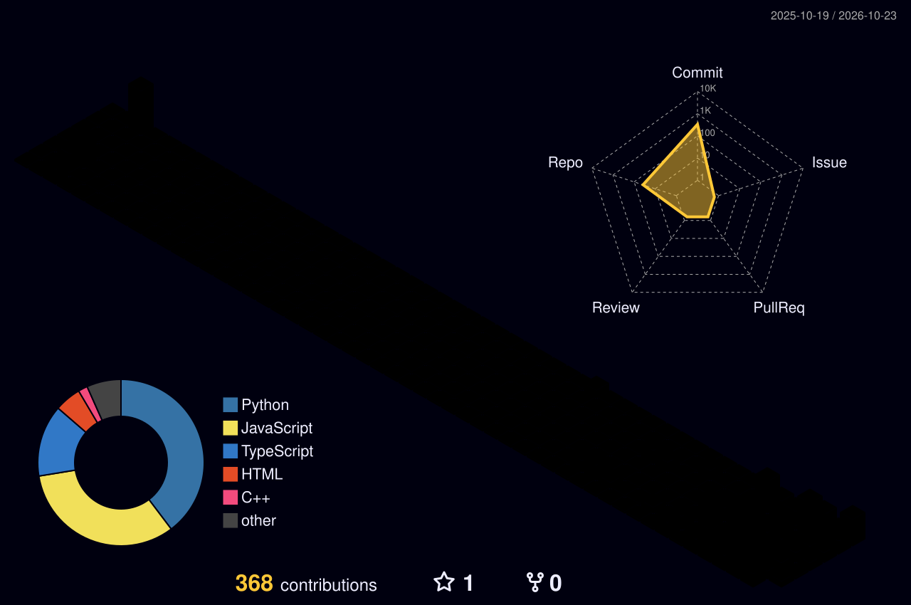

<!-- ============ 3D / ANIMATED HEADER ============ -->
<div align="center">


<a href="https://git.io/typing-svg">
  
</a>

<br/>


</div>


## 👩‍💻 `whoami`

```python
class HeshmaSree:
    role      = "Aspiring Software Engineer"
    education = "B.Tech in CSE (2023 – 2027)"
    skills    = ["Full Stack", "AI / ML", "Cloud", "SAP"]
    dsa       = "400+ LeetCode problems solved"
    exploring = ["System Design", "Cloud Computing", "LLMs"]
    mission   = "Build scalable software & AI-powered applications"

    def status(self):
        return "Learning, building, shipping 🚀"
```


## 🛠️ Tech Stack

<div align="center">

**Languages**


**Frontend**


**Backend**


**Databases**


**AI / ML**


**Cloud & DevOps**


**Enterprise**


</div>


## 🚀 Featured Projects

<div align="center">
<table>
<tr>
<td width="33%" valign="top">

### 🛒 OmniMarket
**Enterprise AI Marketplace**

AI-powered multi-vendor marketplace with smart product discovery and vendor management.


</td>
<td width="33%" valign="top">

### 🤖 VigilAI
**Intelligent Online Proctoring**

Face detection, eye tracking and suspicious-activity monitoring for secure online exams.


</td>
<td width="33%" valign="top">

### 📈 Gold & Silver Prediction
**LSTM Forecasting**

Time-series model with 98% prediction accuracy built on TensorFlow.


</td>
</tr>
</table>
</div>


## 📊 GitHub Analytics

<div align="center">


<br/>


<br/><br/>


</div>

## 🧊 3D Contribution Graph

<div align="center">

<!-- Generated by the workflow in .github/workflows/profile-3d.yml -->


</div>

## 🐍 Contribution Snake

<div align="center">

<!-- Generated by the same workflow (pushed to the `output` branch) -->
<picture>
  <source media="(prefers-color-scheme: dark)" srcset="https://raw.githubusercontent.com/heshmasree2809/heshmasree2809/output/github-snake-dark.svg" />
  
</picture>

</div>


## 💻 Coding Profile

<div align="center">


</div>

- 🧩 **500+ problems solved** on LeetCode
- 🧠 Strong foundation in Data Structures & Algorithms
- 🔁 Regular problem solver and continuous learner

## 📜 Certifications

<div align="center">


</div>

## 🎯 Areas of Interest

<div align="center">

`Software Engineering` · `Artificial Intelligence` · `Machine Learning` · `Backend Development` · `Full Stack Development` · `Cloud Computing` · `SAP Technologies`

</div>

## 📫 Connect with Me

<div align="center">

<a href="mailto:avuthuheshmasree@gmail.com"></a>
<a href="https://www.linkedin.com/in/avuthu-heshma-sree-51a077303/"></a>
<a href="https://github.com/heshmasree2809"></a>
<a href="https://leetcode.com/u/avuthuheshmasree/"></a>

<br/><br/>


</div>
